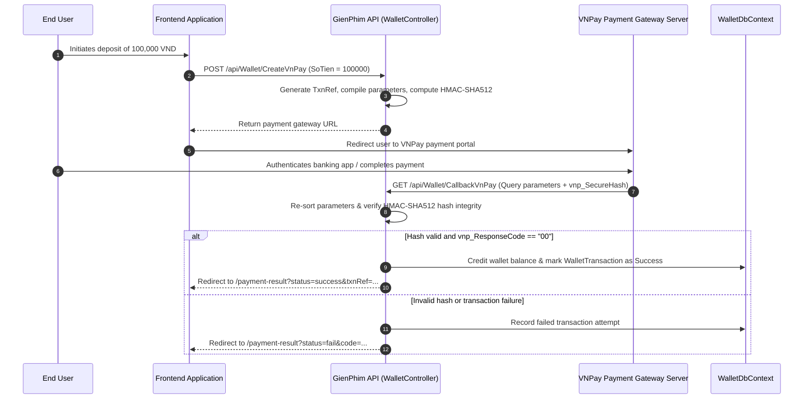

# Native and Integration Engine Specifications

## 1. Overview

GienPhim API interfaces with external platforms and local operating system resources to deliver media catalog ingestion, payment settlement, single sign-on identity, transactional messaging, and physical file asset management. This document outlines the technical design, protocols, and security mechanisms governing these integrations.

---

## 2. External Film Catalog Integration (PhimApi)

The catalog engine connects to external content provider APIs (`https://phimapi.com/`) to retrieve up-to-date film metadata, streaming episodes, and category taxonomies.

### 2.1 Transport Layer & HttpClient Configuration
Because third-party media endpoints may enforce strict TLS validation or bot protection filters, the HTTP client pipeline is configured with hardened network parameters:

```csharp
services.AddHttpClient<IExternalApiClient, ExternalApiClient>((sp, client) =>
{
    var config = sp.GetRequiredService<IConfiguration>();
    client.BaseAddress = new Uri(config["ServiceUrls:PhimApi"]);
    client.Timeout = TimeSpan.FromSeconds(60);
    client.DefaultRequestHeaders.UserAgent.ParseAdd("Mozilla/5.0 (compatible; GienPhimBot/1.0; +https://gienphim.vn)");
})
.ConfigurePrimaryHttpMessageHandler(() => new HttpClientHandler
{
    SslProtocols = SslProtocols.Tls12 | SslProtocols.Tls13,
    ServerCertificateCustomValidationCallback = HttpClientHandler.DangerousAcceptAnyServerCertificateValidator,
    AutomaticDecompression = DecompressionMethods.GZip | DecompressionMethods.Deflate
});
```

### 2.2 Payload Schema & Data Translation
The crawler receives nested JSON documents containing film metadata, video servers, and episode chunks:
1. **Catalog Pagination**: Queries `danh-sach/phim-moi-cap-nhat?page={page}` returning paginated arrays of film stubs.
2. **Detailed Ingestion**: Queries `phim/{slug}` returning full film metadata, duration, release year, posters, and embedded episode streams (`m3u8` or `mp4` sources).
3. **Domain Translation**: The `IApiPhimMapper` and `IApiPhimFactory` translate external DTO representations into local domain aggregates (`Phim`, `TapPhim`, `TheLoai`, `QuocGia`), ensuring schema decoupling.

---

## 3. VNPay Payment Gateway Engine

The payment module integrates with the **VNPay Payment Gateway** to facilitate fiat top-ups into user digital wallets.



### 3.1 Checksum Integrity (HMAC-SHA512)
VNPay security requires that all query parameters are sorted alphabetically by ASCII byte order before hashing:
1. Collect all parameters prefixed with `vnp_` (excluding empty values and `vnp_SecureHash`).
2. Sort keys alphabetically.
3. Concatenate key-value pairs formatted as `key1=value1&key2=value2`.
4. Compute `HMAC-SHA512` against the pre-shared `HashSecret`.
5. Compare the resulting hash against `vnp_SecureHash` received in the callback.

---

## 4. Google OAuth2 Single Sign-On Integration

The authentication module integrates with Google Identity Platform to provide passwordless, frictionless user onboarding.

### 4.1 Token Verification Flow
1. The client Web/Mobile app completes Google Sign-In and receives a Google ID Token (JWT).
2. The client transmits the token via `POST /api/Auth/LoginWithGoogleToken` (`ExternalAuthTokenRequestDTO`).
3. GienPhim API invokes `GoogleJsonWebSignature.ValidateAsync(idToken, validationSettings)` to verify:
   - Token signature validity against Google public certificates.
   - Token issuer (`accounts.google.com` or `https://accounts.google.com`).
   - Token expiration (`exp`).
4. Upon successful validation, the system extracts claims (`email`, `name`, `sub`, `picture`), creates a user record if not present, and issues an internal GienPhim JWT access token.

---

## 5. Transactional Messaging Engine (SMTP / MailKit)

Transactional notifications and security verifications are handled via MailKit over SMTP:
- **Transport Security**: Requires explicit SSL/TLS on port 587 (STARTTLS) or port 465 (SSL).
- **Templates**: `EmailTemplateService` compiles responsive HTML emails for:
  - Password Reset OTP verification (6-digit numeric token with 10-minute expiration).
  - Email Address Change verification.

---

## 6. Local Storage Engine (`Shared.FileStorage`)

GienPhim API implements a high-performance local disk storage engine designed to manage static media assets and user-uploaded content.

### 6.1 Directory Structure
Static files are served directly through ASP.NET Core static file middleware from `wwwroot/`:

```
wwwroot/
├── images/
│   ├── banners/     # Film promotional banners and hero carousels
│   └── films/       # Film posters and cover art
├── uploads/
│   └── avatars/     # User profile avatar uploads
└── videos/
    └── episodes/    # Locally hosted episode chunks or video files
```

### 6.2 Asset Safety and Sanitization
The `FileHelper` and `SlugHelper` utilities ensure file system integrity:
1. **Name Normalization**: Strips diacritics and special characters from file names using Unicode Form D normalization:
   ```csharp
   string normalized = input.Normalize(NormalizationForm.FormD);
   // Regex removes non-spacing marks, spaces replaced with hyphens
   string safe = Regex.Replace(noDiacritics.ToLower(), @"\s+", "-");
   safe = Regex.Replace(safe, @"[^a-z0-9-_]", "");
   ```
2. **Unique Identifier Prepending**: All uploaded image files are stamped with a unique `Guid.NewGuid()` prefix to prevent filename collision.
3. **Safe Deletion**: Deletion requests validate path references before executing `File.Delete()`, ensuring files cannot be deleted outside the target `wwwroot` boundaries.
