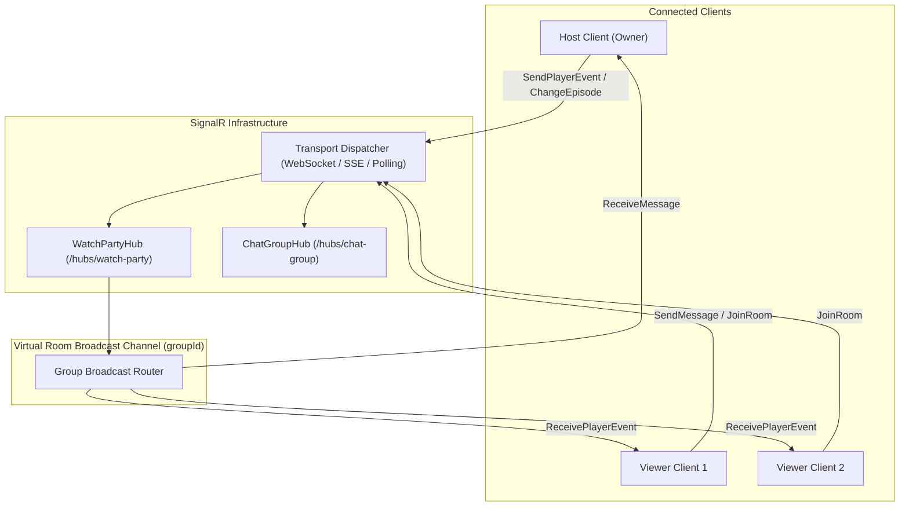
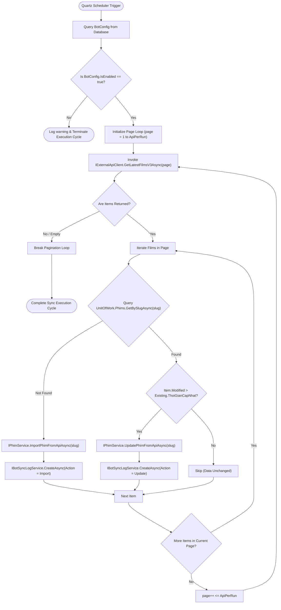

# Real-Time Engine and Data Synchronization Pipelines

## 1. Overview

GienPhim API utilizes two foundational engines for asynchronous, high-throughput data processing:
1. **ASP.NET Core SignalR**: Provides low-latency, bidirectional WebSocket communication for the social Watch Party feature and room settings governance.
2. **Quartz.NET Enterprise Scheduler**: Drives an autonomous 24/7 background data ingestion pipeline, synchronizing media catalogs from external providers and dynamically adapting its execution triggers based on live database state.

---

## 2. Real-Time Transport Architecture (SignalR)

SignalR enables persistent, low-overhead full-duplex communication channels between client applications (Web/Mobile) and the ASP.NET Core host.

### 2.1 Hub Specifications

#### A. WatchPartyHub (`/hubs/watch-party`)
Responsible for synchronized video playback coordination and live room communication:

| Method Name | Parameters | Target Recipients | Operational Behavior |
| :--- | :--- | :--- | :--- |
| `JoinRoom` | `string groupId` | Caller | Registers current WebSocket `ConnectionId` into SignalR group `groupId`. |
| `ChangeEpisode` | `string groupId, EpisodeSyncDto episode` | `OthersInGroup(groupId)` | Broadcasts `ReceivePlayerEvent("changeEpisode", episode)` to all peers in the room. |
| `SendPlayerEvent` | `string groupId, string eventType, double currentTime` | `OthersInGroup(groupId)` | Transmits playback triggers (`play`, `pause`, `seek`) alongside timestamp in seconds. |
| `SendMessage` | `string groupId, string userId, string message` | `Group(groupId)` | Broadcasts formatted chat message payload to all group participants. |

#### B. ChatGroupHub (`/hubs/chat-group`)
Responsible for group administrative synchronization:

| Method Name | Parameters | Target Recipients | Operational Behavior |
| :--- | :--- | :--- | :--- |
| `UpdateSettings` | `Guid groupId, ChatGroupUpdateSettingsDTO dto` | `Group(groupId)` | Validates user role via `ICurrentUserService`, persists settings, and broadcasts `SettingsUpdated`. |

---

### 2.2 Playback Synchronization Mechanics

To achieve seamless video synchronization across geographically distributed viewers with varying network bandwidths, the platform implements a client-reconciliation strategy:

1. **Host-Driven Authority**: The room host (or designated controller) generates authoritative playback events:
   - `play`: Resumes video stream at specified timestamp.
   - `pause`: Halts video stream immediately across peers.
   - `seek`: Re-positions the playback cursor.
2. **Drift Detection & Compensation**:
   - Clients maintain internal drift calculation: `Drift = Math.Abs(LocalPlayerTime - IncomingServerTime)`.
   - If `Drift <= 1.5 seconds`: The client ignores minor micro-variations to prevent audio stuttering.
   - If `Drift > 1.5 seconds`: The client video player forces a seek reconciliation to snap to the authoritative timestamp.
3. **Episode Transitions**:
   - When the host invokes `ChangeEpisode`, the payload contains target episode ID, streaming HLS/MP4 URL, and episode index.
   - Client players tear down the active media source buffer, instantiate the new stream URL, and wait for host play signal.

### 2.3 Connection Lifecycle and Heartbeat
- **Transport Negotiation**: SignalR attempts native WebSockets initially; if intermediate corporate proxies or firewalls reject WebSocket upgrades, the connection gracefully downgrades to Server-Sent Events (SSE) or Long Polling.
- **Heartbeat Protocol**: A keep-alive ping is exchanged every 15 seconds. If no response arrives within 30 seconds, the host triggers `OnDisconnectedAsync` and cleans up allocated group descriptors.
- **Reconnection Handling**: The frontend client registers automatic reconnection policies with exponential backoff (`[0, 2000, 10000, 30000]` milliseconds). Upon re-establishing connectivity, the client calls `JoinRoom` to re-synchronize state.

---

## 3. Background Data Synchronization Pipeline (Quartz.NET)

The platform embeds Quartz.NET 3.15 hosted services directly into the ASP.NET Core process runtime, delivering high-reliability media crawling without external orchestration dependencies.

### 3.1 Worker Roles and Responsibilities

#### 1. SyncPhimJob (`IJob`)
- **Execution Target**: Scheduled execution of media crawling from third-party content API (`https://phimapi.com/`).
- **Resilience Controls**:
  - Traverses pagination dynamically up to `BotConfig.ApiPerRun` pages per cycle.
  - Compares the provider's `modified.time` against local `ThoiGianCapNhat` to guarantee idempotent data mutations.
  - Ingests film metadata, director records, actor assignments, episode streaming links, and thumbnail assets.
  - Wraps item processing in isolated exception blocks so individual failures do not interrupt the larger ingestion batch.

#### 2. BotConfigWatcherJob (`[DisallowConcurrentExecution]`)
- **Execution Target**: Periodic configuration observer executing every 5 minutes.
- **Dynamic Rescheduling Engine**:
  - Compares `BotConfig.LastUpdated` against `_lastChecked` static memory marker.
  - If configuration updates are identified (such as administrator updating `IntervalHours` from 6 hours to 2 hours via Admin UI), it accesses `ISchedulerFactory`, unbinds the existing trigger `SyncPhimJob-trigger`, and schedules an updated trigger with new intervals immediately.
  - Eliminates the need to restart the application or deploy configuration files to modify crawling intervals.

### 3.2 Audit and Operational Telemetry

Every sync event generates an immutable record within `BotSyncLog`:
- `PhimName`: Title of the targeted film asset.
- `PhimSlug`: Unique identifier slug.
- `Action`: Ingestion type (`Import` for new titles, `Update` for modified episodes/metadata).
- `Message`: Execution summary or exception traceback.
- `CreatedAt`: UTC timestamp of the operation.
