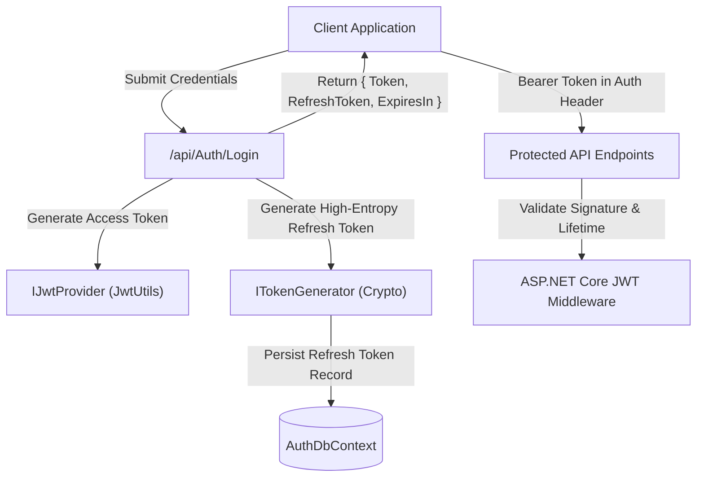
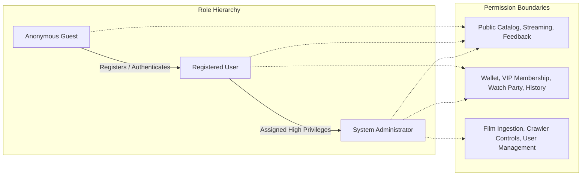

# State and Security Architecture

## 1. Overview

GienPhim API is engineered with a zero-trust mindset, ensuring robust confidentiality, data integrity, and strict authorization enforcement across all public endpoints, real-time channels, and background services.

---

## 2. Authentication & Identity Management

Authentication relies on stateless **JSON Web Tokens (JWT)** reinforced by persistent, rotating **Refresh Tokens**.



### 2.1 Access Token Specifications
- **Algorithm**: `HMAC-SHA256` (Symmetric Security Key).
- **Default Expiration**: 30 minutes.
- **Embedded Claims**:
  - `sub`: User unique identifier (`UserId`).
  - `name`: Display name (`TenND`).
  - `email`: Registered email address.
  - `role`: Role claim string (`Admin`, `User`).
  - `jti`: Unique token identifier (UUID).

### 2.2 Refresh Token Lifecycle & Rotation
- **Entropy**: Cryptographically secure 64-byte random byte sequence generated via `RandomNumberGenerator` and converted to Base64.
- **Persistence**: Recorded in `AuthDbContext.RefreshTokens` alongside `UserId`, `ExpiresAt`, and `IsRevoked`.
- **Rotation Rule**: When `/api/Auth/RefreshToken` is invoked:
  1. The existing refresh token is checked for expiration and revocation status.
  2. The old refresh token is marked as revoked (`IsRevoked = true`).
  3. A new access token and a replacement refresh token are generated and returned.
- **Logout Revocation**: Invoking `/api/Auth/LogOut` marks the user's active refresh token as revoked, preventing future sessions from being initiated with that token.

---

## 3. Role-Based Access Control (RBAC)

The system enforces a 3-tier authorization model:



Authorization is enforced at the ASP.NET Core controller level using declarative attributes:
- `[AllowAnonymous]`: Open access for public browsing, search, and login.
- `[Authorize]`: Restricted to authenticated users holding a valid JWT.
- `[Authorize(Roles = "User,Admin")]`: Operations permitted for general users and administrative accounts.
- `[Authorize(Roles = "Admin")]`: Sensitive administrative interfaces (film CRUD, bot configuration, user deletion).

---

## 4. Transport & Network Security

### 4.1 Strict TLS Protocol Enforcement
The application explicitly disables legacy insecure SSL protocols (SSL 3.0, TLS 1.0, TLS 1.1) in `Program.cs`:
```csharp
System.Net.ServicePointManager.SecurityProtocol =
    System.Net.SecurityProtocolType.Tls12 |
    System.Net.SecurityProtocolType.Tls13;
```
All outbound connections (such as crawling data from PhimApi or calling the VNPay gateway) are restricted to TLS 1.2 or TLS 1.3.

### 4.2 Cross-Origin Resource Sharing (CORS) Policy
Because SignalR WebSockets require credential forwarding, CORS policies are tightly constrained:
```csharp
builder.Services.AddCors(options =>
{
    options.AddPolicy("AllowFrontend", policy =>
    {
        policy.WithOrigins("http://localhost:3000")
              .AllowAnyHeader()
              .AllowAnyMethod()
              .AllowCredentials();
    });
});
```
In production deployments, wildcard origins (`*`) are prohibited whenever `AllowCredentials` is active.

---

## 5. Payment Security & Data Integrity

### 5.1 VNPay Checksum Validation
To prevent parameter tampering or man-in-the-middle manipulation of payment amounts:
- Parameters are sorted by ASCII code before generating or verifying the signature.
- Checksums are calculated using `HMAC-SHA512` with the merchant secret key.
- The callback endpoint re-computes the hash on all received fields and matches it with `vnp_SecureHash`. Mismatched requests are rejected immediately.

### 5.2 Wallet Idempotency
Wallet debit operations (such as purchasing memberships) enforce atomic balance checks before applying deductions. Transactions are ledgered into `WalletTransactions` with reference identifiers, preventing duplicate double-spend attacks.

---

## 6. Defensive Coding & Error Sanitation

1. **Model Validation Filter**: `ValidateModelAttribute` validates incoming request models before controller execution. Invalid model states produce a standardized 400 Bad Request envelope containing exact validation violation details.
2. **Exception Handling Middleware**: Global exception middleware intercepts unhandled exceptions, logs full stack traces internally to application logs, and returns sanitized generic error envelopes to clients to prevent database schema or credential leakage.
