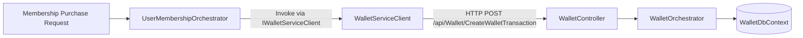
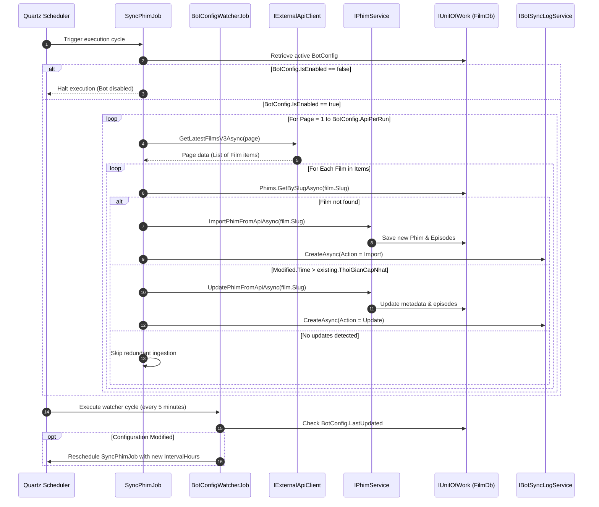
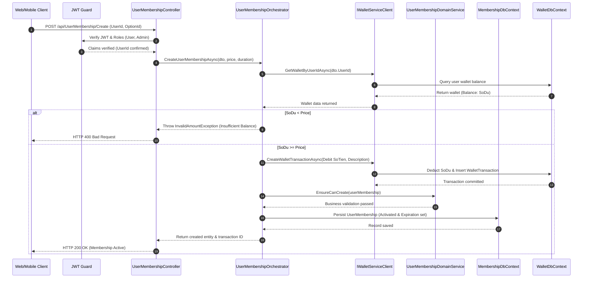
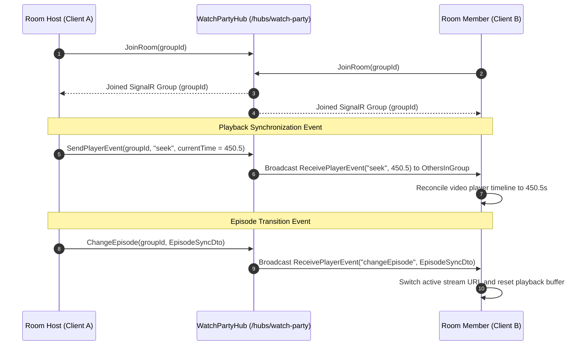

# System Architecture and Design Document

## 1. Executive Architecture Summary

GienPhim API is structured as a **Domain-Driven Modular Monolith** implemented on ASP.NET Core (.NET 8.0). Rather than adopting a microservice fleet that introduces network serialization overhead and distributed transaction complexity at early phases, the platform organizes distinct business subdomains into isolated modules residing in a unified deployable unit.

Each module maintains strict layer decoupling:
- **Domain Layer**: Contains pure business entities, value objects, domain events, domain service contracts, and domain exceptions without dependencies on UI or database persistence frameworks.
- **Application Layer**: Houses business orchestrators, application services, data transfer objects (DTOs), validators, factory interfaces, and repository abstractions.
- **Infrastructure Layer**: Implements database persistence using Entity Framework Core DbContexts, external HTTP client adapters, cryptographic token utilities, and repository implementations.
- **API Layer**: Exposes HTTP REST controllers, middleware pipelines, and SignalR hubs.

```mermaid
graph TD
    subgraph Host ["ASP.NET Core Web Host (Program.cs)"]
        direction TB
        subgraph ModAuth ["AuthService Module"]
            AuthApi["Api (AuthController)"]
            AuthApp["Application (AuthOrchestrator)"]
            AuthDom["Domain (UserClaims, Tokens)"]
            AuthInfra["Infrastructure (AuthDbContext, JwtUtils)"]
            AuthApi --> AuthApp --> AuthDom
            AuthApp --> AuthInfra
        end

        subgraph ModFilm ["FilmService Module"]
            FilmApi["Api (PhimController, BotConfigController)"]
            FilmApp["Application (PhimOrchestrator, SyncPhimJob)"]
            FilmDom["Domain (Phim, TapPhim, TheLoai)"]
            FilmInfra["Infrastructure (FilmDbContext, ExternalApiClient)"]
            FilmApi --> FilmApp --> FilmDom
            FilmApp --> FilmInfra
        end

        subgraph ModInter ["InteractionService Module"]
            InterApi["Api (ChatGroupController, WatchPartyHub)"]
            InterApp["Application (ChatGroupOrchestrator)"]
            InterDom["Domain (ChatGroup, ChatMessage)"]
            InterInfra["Infrastructure (InteractionDbContext)"]
            InterApi --> InterApp --> InterDom
            InterApp --> InterInfra
        end

        subgraph ModWallet ["WalletService Module"]
            WalletApi["Api (WalletController)"]
            WalletApp["Application (WalletOrchestrator)"]
            WalletDom["Domain (Wallet, WalletTransaction)"]
            WalletInfra["Infrastructure (WalletDbContext, VnPayClient)"]
            WalletApi --> WalletApp --> WalletDom
            WalletApp --> WalletInfra
        end

        subgraph ModMember ["MembershipService Module"]
            MemberApi["Api (UserMembershipController)"]
            MemberApp["Application (UserMembershipOrchestrator)"]
            MemberDom["Domain (MembershipPlan, UserMembership)"]
            MemberInfra["Infrastructure (MembershipDbContext)"]
            MemberApi --> MemberApp --> MemberDom
            MemberApp --> MemberInfra
        end
    end
```

- **Shared Kernel**: Supplies base exception definitions, generic `Result<T>` execution envelopes, and common validation markers.

---

## 2. Bounded Context Decoupling & Inter-Service Communication

To guarantee that modules remain independently testable and maintainable, direct cross-domain entity referencing is strictly forbidden. Communication between bounded contexts adheres to two decoupled patterns:
1. **In-Process Dependency Injection (Shared Contracts)**: Shared interfaces registered with scoped lifetime across the runtime container.
2. **Typed HTTP Inter-Service Adapters**: When invoking operations across operational boundaries (such as `MembershipService` debiting a user's wallet via `WalletServiceClient`), requests transit through typed HTTP clients with explicit timeout and error isolation.

---

## 3. High-Value Sequence Execution Workflows

### 3.1 Automated Film Crawling and Delta Ingestion Workflow
The automated crawler pipeline periodically scans third-party media sources, evaluates delta changes, and updates local catalog records.

---

### 3.2 VIP Membership Purchase and Balance Settlement Flow
Purchasing a VIP membership requires atomic coordination between membership validation and digital wallet debiting.

---

### 3.3 Real-Time Watch Party Playback Synchronization Flow
Watch party participants maintain synchronized video playback positions through WebSocket event broadcast.

---

## 4. Multi-DbContext Partitioning and Data Strategy

To maintain clean separation between domains, data persistence is partitioned across 8 independent Entity Framework Core database contexts within Microsoft SQL Server:

| DbContext | Managed Domain Aggregate | Migration Scope |
| :--- | :--- | :--- |
| `AuthDbContext` | Refresh tokens, authentication audits | User session and token lifecycle tracking |
| `UserDbContext` | Users, Roles, Profile metadata | Core user identities, credentials, authorization |
| `FilmDbContext` | Films, Episodes, Directors, Actors, Genres, Tags, Views, History, BotConfigs, BotSyncLogs | Streaming media catalog and ingestion telemetry |
| `InteractionDbContext` | ChatGroups, ChatMessages, GroupMembers, JoinRequests, Feedbacks | Social collaboration and watch party room state |
| `MembershipDbContext` | MembershipPlans, PlanOptions, UserMemberships | VIP subscription tiers and entitlement validity |
| `WalletDbContext` | Wallets, WalletTransactions | Ledger entries, deposit audit, internal balance |
| `OrderDbContext` | Orders, OrderDetails | Customer cart checkout records |
| `PaymentDbContext` | PaymentMethods, PaymentTransactions | Low-level gateway payment records |

### Transaction Management
Within each individual context, mutations are encapsulated using the `UnitOfWork` and `EfTransaction` pattern. This guarantees that operations either commit completely or roll back in full, preserving database integrity.
